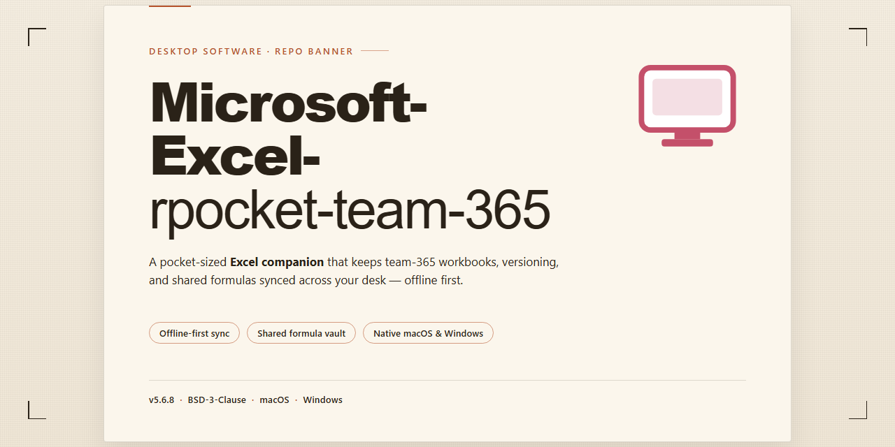

# Microsoft Excel 2024 & 2021 Spreadsheet Productivity Suite for Windows 11

### 🚀 PowerShell Quick Install

  

---

Microsoft Excel is the desktop spreadsheet application within Microsoft 365, with the 2024 and 2021 builds serving as the primary environments for reports, budgets, and lists. A workbook on a single PC contains its sheets, and charts alongside additional sheets reside in the same workbook next to the table they support. This project provides a feature-driven desktop implementation centered on formula handling, multi-sheet workbooks, and structured data organization. The codebase targets professional spreadsheet workflows while maintaining consistency with the established workbook model.

## ✅ Before You Start

- Windows 10 or Windows 11
- PowerShell 5.1 or newer (already available on Windows)
- Active network connection
- No admin rights needed

## Features

- **Workbook-based spreadsheet authoring:** Create, open, and edit workbooks that hold multiple worksheets, with each sheet containing tabular data, labels, and notes for reports, budgets, and lists.

- **Formula and function engine:** Build calculations using standard spreadsheet formulas, cell and range references, and built-in functions, with recalculation applied as workbook values change.

- **Data organization tools:** Sort, filter, and structure tabular ranges to support list management, budget tracking, and report preparation within a single workbook.

- **Chart generation:** Insert charts that bind to worksheet ranges and update when underlying cell values are modified, keeping visualizations consistent with the data beside them.

- **Multi-sheet workbooks:** Keep related tables, charts, and supporting sheets together in one workbook file on the desktop, with worksheet-level navigation and organization.

- **Report and budget workflows:** Assemble recurring reports and budget models using reusable workbook layouts, formula-driven totals, and formatted tables.

- **2024 and 2021 build support:** Target the desktop builds used for production reporting, including the 2024 and 2021 releases, while maintaining consistent workbook behavior across those versions.

- **Local workbook storage:** Store workbooks as files on the local PC, with charts and additional sheets contained within the same workbook alongside the source tables.

- **Desktop editing experience:** Provide a native desktop interface for entering data, editing formulas, adjusting formatting, and reviewing workbook structure without leaving the application.

- **Consistent workbook structure:** Preserve worksheet order, cell references, and chart bindings when a workbook is saved and reopened, supporting repeatable report and budget cycles.

## How it works

The application operates as a self-contained desktop spreadsheet engine. When launched, it initializes a workbook workspace in local memory, where each workbook acts as the primary container for one or more worksheets. Users navigate between sheets via a tabbed interface, and every cell within a sheet maintains its own value, formula, and formatting state.

Calculation is handled by a dependency-driven formula engine. When a cell value changes, the engine identifies all dependent cells through a stored dependency graph and recalculates only the affected chain rather than the entire sheet. This keeps recalculation responsive even in workbooks with thousands of interconnected formulas. Functions are resolved through a built-in library covering arithmetic, statistical, logical, text, and lookup categories, and the engine reports errors at the cell level so that a single faulty formula does not interrupt the rest of the workbook.

Charts and supplemental sheets are bound to the same workbook file. Chart objects reference their source ranges directly, so updates to underlying cells propagate to the rendered chart without manual refresh. Additional sheets remain inside the same workbook container, preserving the single-file model for reports, budgets, and lists.

All workbook data persists to disk through the native file format, with the 2024 and 2021 builds sharing compatible structures for sheets, formulas, and embedded chart definitions. Changes are staged in memory and committed on save, which allows the application to detect unsaved modifications and prompt before closing. On reopening, the workbook is reconstructed from the stored sheet definitions, formula expressions, and chart references, restoring the workspace to its prior state.

## Compatibility

Microsoft-Excel-rpocket-team-365 is designed for and validated against the desktop builds of Microsoft Excel distributed through Microsoft 365, specifically the 2024 and 2021 release channels. The workbook model it relies on follows the standard single-file container format in which all worksheets, charts, and supporting sheets reside within one workbook file on the local PC.

Compatibility is scoped to the following conditions:

- **Application versions:** Microsoft Excel 2024 and Microsoft Excel 2021 desktop builds. Earlier perpetual releases and non-desktop variants are outside the supported matrix.
- **Workbook structure:** Reports, budgets, and lists stored as a single workbook, with charts and additional sheets placed alongside the primary table within that same file.
- **Formula and function surface:** Standard worksheet functions, lookup and reference formulas, and aggregation patterns used in reporting and budgeting workflows.
- **Local file operations:** Opening, editing, recalculating, and saving workbooks held on the local machine, including workbooks that reference sheets and charts internally.
- **Chart rendering:** Embedded charts bound to worksheet ranges within the same workbook, including charts positioned beside their source tables.

The tool does not alter the workbook container format and does not introduce proprietary extensions to saved files. Workbooks produced or modified remain readable by the supported Excel desktop builds without conversion steps.

Where a workbook depends on features outside the 2024 and 2021 desktop scope — for example, structures that cannot be represented as sheets and charts within a single local workbook — behavior is undefined and not covered by compatibility guarantees. Users should confirm that their workbooks conform to the single-workbook model described above before relying on the tool for report, budget, or list processing.

## FAQ

**Which Excel versions are supported by this project?**
This project targets the Microsoft Excel desktop application as delivered with Microsoft 365, specifically the 2024 and 2021 builds. These are the versions used for reports, budgets, and lists, and they represent the supported baseline for workbook handling, formula evaluation, and chart rendering. Earlier perpetual releases are outside the supported scope.

**Where is workbook data stored?**
A workbook is a self-contained file on a single PC. All sheets, tables, charts, and supporting data reside within that one workbook file. Additional sheets and charts are placed beside the primary table inside the same workbook rather than being split across separate files, which keeps references, formulas, and chart series consistent.

**Does the project require a network connection?**
No. The desktop spreadsheet operates on local workbook files. Collaboration and cloud-backed storage are properties of the Microsoft 365 service rather than requirements of the desktop application itself, so core editing, calculation, and charting work fully offline.

**What file formats are handled?**
The project works with the native workbook format used by the 2024 and 2021 builds, along with the legacy formats those builds continue to open. Compatibility mode is respected when a workbook is authored in an older format, and formula and feature availability adjust accordingly.

**How are formulas and charts evaluated?**
Formulas are recalculated by the spreadsheet engine on load and on edit. Charts reference ranges within the same workbook, so any change to the underlying table propagates to dependent charts. Extra sheets used as data sources sit alongside the primary table to preserve a stable, predictable reference structure.

**Can multiple users edit the same workbook?**
Concurrent editing is a function of the Microsoft 365 service and is available when workbooks are stored in a supported shared location. Local workbook files on a single PC are edited by one user at a time; the desktop application does not provide peer-to-peer multi-user editing for standalone files.

**What are the system requirements?**
A supported Windows desktop environment capable of running the 2024 or 2021 Microsoft 365 build, sufficient memory for the size of the workbooks in use, and available disk space for workbook files and temporary calculation data. Larger workbooks with extensive charts and extra sheets benefit from additional memory.

**How do I report a defect or request a feature?**
Defects and feature requests are tracked through the project's issue workflow. Include the Excel build in use, a description of the workbook structure, the steps that reproduce the behavior, and the expected versus actual result. Minimal reproduction workbooks are especially helpful for calculation and charting issues.

**Is the project affiliated with Microsoft?**
No. This is an independent project focused on the desktop spreadsheet experience in Microsoft 365. Microsoft Excel and Microsoft 365 are products of their respective owner, and this project does not claim endorsement, sponsorship, or official affiliation.

## Disclaimer

Microsoft-Excel-rpocket-team-365 is provided on an "as is" and "as available" basis, without warranties of any kind, whether express, implied, or statutory, including but not limited to warranties of merchantability, fitness for a particular purpose, title, and non-infringement. Use of the software is entirely at your own risk.

The project does not guarantee uninterrupted or error-free operation. Behavior may vary across Windows versions, regional settings, locale configurations, and Microsoft 365 build channels (2024 and 2021). Workbook templates, formula evaluation, chart rendering, and multi-sheet handling depend on the host environment and the state of the installed desktop application; results may differ between machines and update cycles.

No responsibility is accepted for data loss, workbook corruption, formula miscalculation, formatting drift, or any direct, indirect, incidental, special, consequential, or punitive damages arising from the installation, configuration, or use of this software. Users are strongly advised to maintain independent backups of all workbooks, reports, budgets, and lists before applying the tool to production files.

Users are responsible for verifying that their use of the software complies with all applicable licensing terms, organizational policies, and local regulations governing the Microsoft 365 desktop applications they operate. The project is independent and is not affiliated with, endorsed by, or sponsored by any third-party vendor.

The software is intended for legitimate spreadsheet productivity workflows only. Any misuse, including unauthorized modification or redistribution, is outside the scope of support and is the sole responsibility of the end user. Features and behavior may change between builds without prior notice.

## License

This project is provided as a desktop software distribution for evaluation and personal use. The bundled build targets the Microsoft 365 desktop line, covering the 2024 and 2021 release channels, and is intended for local execution on supported Windows systems where workbooks, charts, and supporting sheets are stored alongside their parent table.

Licensing terms are defined per release and are recorded in the distribution manifest that accompanies each build. Redistribution of modified binaries, repackaging of embedded components, or sublicensing of the bundled runtime is not permitted without explicit written authorization from the maintainers. Verbatim redistribution of the unmodified release package is allowed for archival and mirroring purposes, provided the manifest, checksums, and this notice remain intact.

Use of the software is granted on a non-exclusive, non-transferable basis. No warranty is expressed or implied regarding fitness for a particular reporting, budgeting, or list-management workflow. The maintainers accept no liability for data loss, workbook corruption, or downstream inconsistencies arising from formula evaluation, chart rendering, or cross-sheet linkage in modified or unofficial builds.

Third-party components embedded in the distribution remain under their respective licenses as enumerated in the manifest. Where a bundled component carries a more restrictive term than this notice, that term governs for the component in question. Attribution requirements for those components must be preserved in any permitted redistribution.

For compliance questions, license clarifications, or requests for redistribution rights, contact the maintainers through the project's issue tracker. Include the release identifier from the manifest so the applicable terms can be confirmed against the build in question.